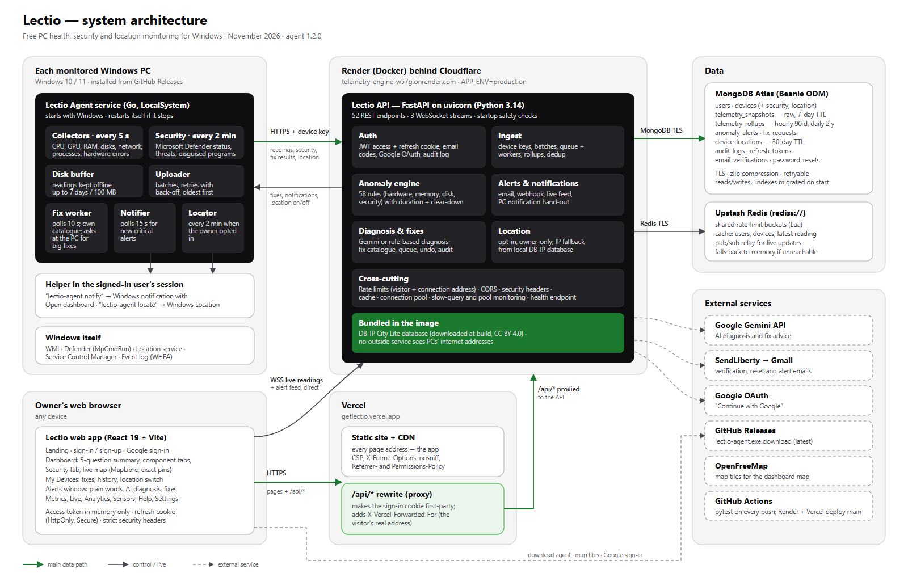

# Lectio

Free PC health, security and location monitoring for Windows.

A small agent on each PC reads its hardware every 5 seconds and checks Microsoft
Defender every 2 minutes. Lectio stores the readings, raises an alert when
something stays outside a safe limit (a hot processor, a failing drive, memory
running out, malware Defender couldn't remove), tells the owner by email, on
the dashboard and with a Windows notification on the PC, explains the likely
cause, and can carry out a fix on the PC once the owner allows it. Owners can
also see where each PC is on a map, if they switch that on.

- **Live site:** https://getlectio.vercel.app
- **API:** https://telemetry-engine-w57g.onrender.com (reached by the site through `/api/*`)
- **Agent download:** https://github.com/wittns-ctrl/Telemetry_engine/releases/latest



## Repository layout

| Path | What it is |
| --- | --- |
| `app/` | The API: FastAPI with Beanie on MongoDB. Routes in `app/api/v1/`, alert rules in `app/core/anomaly_rules.py`, the fix catalogue in `app/core/fix_catalogue.py`. |
| `agent-go/` | **The Windows agent** (Go): a Windows service that collects readings, buffers them offline, uploads them, runs fixes, shows notifications and reports location. See [`agent-go/README.md`](agent-go/README.md). |
| `agent/` | The earlier Python agent, kept for reference and for the server's fix tests. Not shipped. |
| `frontend/` | The website and signed-in app: React 19 and Vite, deployed on Vercel. |
| `tests/` | Backend tests (pytest) against an in-memory database; they never touch a real MongoDB or Redis. |
| `docs/` | Architecture, API, deployment, operations, product and legal documents ([index below](#documentation)). |
| `scripts/` | Build helpers, such as the IP-location database download. |
| `Dockerfile`, `docker-compose.yml` | The API's container image (used by Render) and a local stack with MongoDB. |
| `.github/workflows/tests.yml` | Runs the backend tests on every push to `main` and every pull request. |

## Run it locally

You need Python 3.14 with [uv](https://docs.astral.sh/uv/), Node.js 20.19+ or
22.12+, Go 1.27 (for the agent) and a MongoDB (local, Docker or Atlas).

**API**

```bash
cp .env.example .env
uv sync --all-extras
uv run uvicorn app.main:app --reload --port 8000
```

Set at least `MONGODB_URI`, `MONGO_DB` and `SECRET_KEY` in `.env`. With
`APP_ENV=development` the interactive API docs are at http://localhost:8000/docs
(they are switched off in production).

**Frontend**

```bash
npm --prefix frontend install
npm --prefix frontend run dev
```

Open http://localhost:5173. Point `VITE_API_BASE` in `frontend/.env` at
`http://localhost:8000` to use the local API; the API only accepts browser
requests from `FRONTEND_URL`.

**Agent (on a Windows PC)**

```powershell
cd agent-go
.\build.ps1                                   # local API and site, for development
.\build.ps1 -Api https://your-api -Version 1.2.0   # a release build
```

Double-click `dist\lectio-agent.exe` to sign in, link the PC and install the
service. `lectio-agent run` runs it in a window instead; `lectio-agent status`
shows how uploads are going.

## Tests

```bash
uv run pytest -q                        # backend (630+ tests)
cd agent-go && go test ./...            # agent
npm --prefix frontend run build         # frontend
npx --prefix frontend oxlint frontend/src
```

The backend suite covers sign-in, tenant isolation (nobody can see another
account's devices, readings, alerts, fixes or location), ingestion, every alert
rule, notifications, AI diagnosis, fixes and their safety rules, rate limits
(including behind Render and Vercel), security, location and retention. Tests
force `APP_ENV=development` and in-memory state whatever `.env` says.

## Configuration

Every API setting is listed with comments in [`.env.example`](.env.example);
the frontend's in [`frontend/.env.example`](frontend/.env.example). The ones that
matter in production are explained in [docs/deployment.md](docs/deployment.md).

## Documentation

| Area | Documents |
| --- | --- |
| How it's built | [Architecture](docs/architecture.md) · [API reference](docs/api.md) · [Alert thresholds](docs/alert-thresholds.md) |
| Running it | [Deployment](docs/deployment.md) · [Agent releases](docs/agent-release.md) · [Runbook](docs/runbook.md) · [Backup and restore](docs/backup-restore.md) · [Secrets register](docs/secrets-register.md) · [Incident response](docs/incident-response.md) |
| Product | [Product specification](docs/product-spec.md) · [Roadmap](docs/roadmap.md) · [User guide](docs/user-guide.md) · [Test plan](docs/test-plan.md) |
| Security and legal | [Security policy](SECURITY.md) · [Security assessment](docs/security-assessment.md) · [Legal pages to complete](docs/legal-checklist.md) · [Data processing agreement](docs/data-processing-agreement.md) · [Third-party notices](docs/third-party-notices.md) |
| Project | [Changelog](CHANGELOG.md) · [Contributing](CONTRIBUTING.md) · [Licence](LICENSE) · [UI screenshots](docs/images/ui/) |

## Known limits

- Some readings (CPU package temperature, voltages, fan speeds, drive health)
  depend on what the PC exposes; many PCs report no value and the alert rules
  for them stay silent.
- `lectio-agent.exe` is not code-signed, so Windows SmartScreen warns on first run.
- On Render's free plan the API sleeps after 15 minutes without traffic; the
  first request afterwards takes up to a minute.
- Location from the internet address is city-level and wrong behind a VPN.
