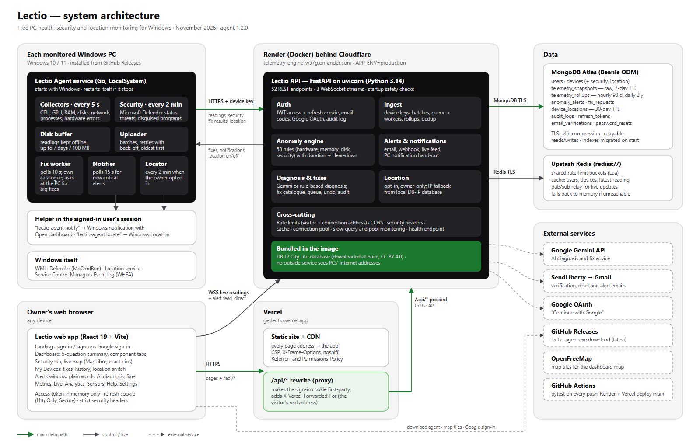
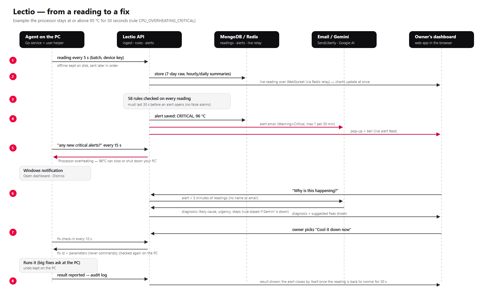

# System architecture

Lectio has four parts: an **agent** on each Windows PC, an **API** on Render, a
**web app** on Vercel, and **data stores** (MongoDB Atlas and Upstash Redis).
The diagram's source is [images/architecture.svg](images/architecture.svg).

## Components

### Windows agent (`agent-go/`, Go)

A Windows service (`LectioAgent`, LocalSystem, automatic start, restarts itself
on failure). It runs these loops side by side:

| Loop | How often | What it does |
| --- | --- | --- |
| Collectors | every 5 s | CPU, GPU, memory, drives, disk and network activity, busiest programs, hardware errors (WHEA, last 24 h) |
| Security | every 2 min, in the background | Microsoft Defender status, threats from the last 30 days, other antivirus products, programs with Windows names in the wrong folder |
| Buffer + uploader | after each reading | readings go to a disk buffer first (up to 7 days / 100 MB), then up in batches, oldest first, with back-off while offline |
| Fix worker | every 10 s | takes fixes chosen on the website; runs only fixes in its own catalogue, re-checks parameters, asks at the PC before big ones, keeps undo records |
| Notifier | every 15 s | takes new critical alerts and shows a Windows notification |
| Locator | every 2 min, if the owner opted in | Windows Location position; sends on a move of more than ~100 m, a status change or every 30 min |

The service runs in session 0, which has no desktop, so notifications and
Windows Location run in a **helper**: the same program started as the
signed-in person (`lectio-agent notify …`, `lectio-agent locate`) through
`internal/usersession`.

Configuration lives in `C:\ProgramData\Lectio\agent.json` (the device key is
encrypted with Windows DPAPI); logs and `status.json` in `C:\ProgramData\Lectio\logs`.

### API (`app/`, Python 3.14, FastAPI)

One uvicorn process in a Docker container on Render, behind Cloudflare.

| Area | Main modules |
| --- | --- |
| Sign-in | `api/v1/auth.py`, `google_auth.py`, `core/security.py` — Argon2 passwords, short-lived JWT access tokens, rotating refresh tokens in an HttpOnly cookie, 6-digit email codes, Google OAuth, audit log |
| Devices | `api/v1/devices.py` — register, rename, country, location switch, delete (cascades) |
| Ingest | `api/v1/ingest.py`, `services/ingest_processor.py`, `telemetry_store.py`, `rollups.py` — device-key auth, batches up to 100, a queue with workers, duplicate-safe event ids, hourly and daily summaries |
| Alerts | `services/anomaly_engine.py`, `core/anomaly_rules.py` — 58 rules with a duration before opening and a clear-down before closing; `alert_notifier.py` emails and webhooks; `websocket.py` live feed |
| Diagnosis | `services/ai_diagnostic_service.py` — Gemini with a rule-based fallback |
| Fixes | `api/v1/fixes.py`, `core/fix_catalogue.py` — queue, fix levels, undo, audit |
| Agent | `agent_alerts.py` (notifications), `agent_location.py` (location), `agent_download.py` |
| Location | `services/ip_location.py` — DB-IP City Lite, memory-mapped, bundled in the image |
| Cross-cutting | `core/rate_limit.py` (Redis token buckets), `core/cache.py`, `core/shared.py`, `core/startup_checks.py`, `db/session.py` (pool, indexes, migrations) |

### Web app (`frontend/`, React 19 + Vite)

A single-page app on Vercel. `vercel.json` serves `index.html` for every page
address, proxies `/api/*` to the API (so the refresh cookie is first-party), and
sets the security headers. WebSockets connect straight to Render
(`VITE_WS_ORIGIN`) with a one-time ticket.

Pages: landing, sign-in, sign-up, forgot and reset password, email
verification, privacy, terms; signed in: Dashboard (summary, component tabs,
Security, map), My Devices, Metrics, Live, Analytics, Sensors, Help, Settings,
and the Alerts window.

### Data stores

**MongoDB Atlas** (Beanie ODM):

| Collection | Holds | Kept for |
| --- | --- | --- |
| `users` | accounts | while the account exists |
| `devices` | PCs, latest security report, location switch and latest position | while the PC is linked |
| `telemetry_snapshots` | raw readings (without process lists or security) | 7 days (TTL) |
| `telemetry_rollups` | hourly and daily summaries | 90 days / 2 years |
| `anomaly_alerts` | alerts | while the account exists |
| `fix_requests` | fixes asked for and their results | while the account exists |
| `device_locations` | past positions | 30 days (TTL) |
| `audit_logs` | sign-in and security events | configured retention |
| `refresh_tokens`, `email_verifications`, `password_resets` | sign-in state | until used or expired |

**Upstash Redis**: rate-limit buckets (atomic Lua), caches for users, devices
and latest readings, and a pub/sub relay so live updates reach browsers
connected to any API process. If Redis is unreachable, the API falls back to
its own memory and keeps working.

## From a reading to a fix

1. The agent sends readings every 5 seconds.
2. The API stores them and pushes each one live to open dashboards.
3. Every reading is checked against 58 rules; a breach must last (for example
   30 s) before an alert opens.
4. The alert is saved, emailed (warning and critical, at most once per 30
   minutes per PC and problem) and pushed to the dashboard's bell and pop-up.
5. For critical alerts the agent picks it up within 15 s and shows a Windows
   notification; its button opens `/?alert=<id>` on the website.
6. The owner asks why: the API sends the alert and 5 minutes of readings (no
   name or email) to Gemini, or uses built-in rules.
7. The owner picks a fix; the agent takes it within 10 s, checks it against its
   own catalogue, asks at the PC if it's big, runs it and keeps an undo record.
8. The result is reported and audited; the alert closes by itself once the
   reading has been back to normal long enough.

## Trust boundaries

| Boundary | Protection |
| --- | --- |
| Browser → API | HTTPS; CORS to the site only; access token in memory; HttpOnly Secure cookie; CSP and frame blocking; rate limits on the visitor's real address |
| Agent → API | HTTPS; per-PC device key (hashed on the server); separate rate-limit buckets per key |
| API → agent | The server can only name a fix from the agent's catalogue; the agent re-checks parameters, asks before big fixes, and builds notification links from its own build-time address |
| Account → account | Every route filters by owner; tests for each kind of data |
| Location | Off by default; owner-only; deleted on switch-off; IP lookups done locally |

## Deployment view

| Piece | Where | Deployed by |
| --- | --- | --- |
| Website | Vercel (`frontend/`) | push to `main` |
| API | Render, Docker image from `Dockerfile` | push to `main` |
| Database | MongoDB Atlas | managed |
| Redis | Upstash | managed |
| Agent | GitHub Releases | by hand ([agent-release.md](agent-release.md)) |

See [deployment.md](deployment.md) for settings and steps.
